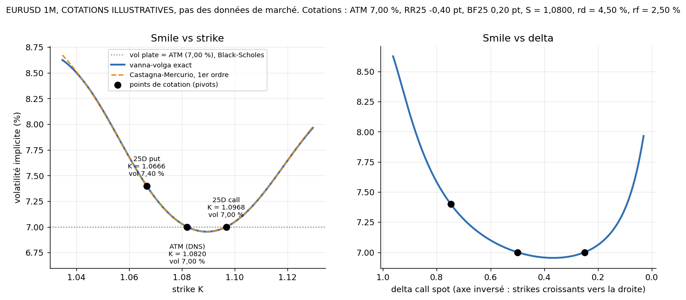
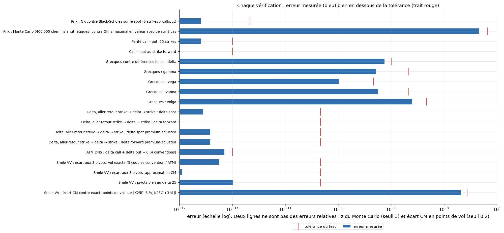
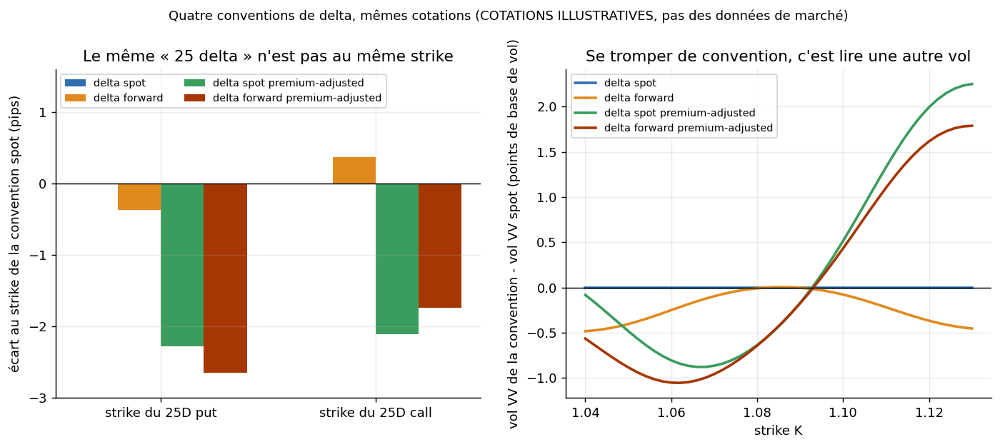
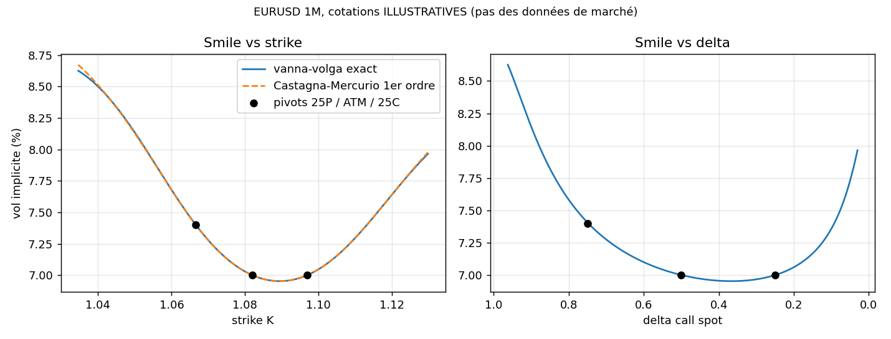

# Options FX : Garman-Kohlhagen, conventions de delta, smile vanna-volga

Pricing d'options FX européennes (Garman-Kohlhagen), des **4 conventions de delta de marché** avec conversion strike ↔ delta, et d'un **smile de volatilité par vanna-volga** (Castagna-Mercurio 2007) construit à partir des cotations ATM / RR25 / BF25, sur des cotations illustratives.

> **At a glance.** Pricing of European FX options (Garman-Kohlhagen), the four market delta conventions with strike-to-delta conversion, and a vanna-volga smile built from ATM / RR25 / BF25 quotes,
> including the market (broker) butterfly vs smile butterfly distinction. Illustrative quotes only, no market data: the checks show internal consistency
> (GK = Black-Scholes on spot is the same formula written twice, not an external validation).

<!-- BEGIN:badges -->
[](https://github.com/yassine-ek/fx-options-vanna-volga/actions/workflows/tests.yml)


<!-- END:badges -->

## Résultats clés

<!-- BEGIN:cles -->
- **Pricer Garman-Kohlhagen cohérent avec lui-même** : GK et sa réécriture Black-Scholes-Merton sur le spot coïncident à 1,7e-16. *Réserve : c'est une cohérence entre deux écritures de la même formule (forward contre spot), pas une validation externe ; les grecques sont validées contre des différences finies (écart relatif maximal 1,6e-4) et les prix contre Monte Carlo (|z| ≤ 0,94 sur 8 cas, tous du même signe et corrélés car tirés sur les mêmes chemins : pas huit validations indépendantes). Aucune référence externe (QuantLib, tables publiées) n'est utilisée.*
- **Quatre conventions de delta, avec conversion strike ↔ delta** : aller-retour exact à 5,6e-16 près, delta d'un call premium-adjusted non monotone géré (branche haute, maximum 0,9024). Le même « 25 delta » change de strike d'environ 2,7 pips entre delta spot et premium-adjusted, soit jusqu'à 2,3 pb de vol lus de travers. *Réserve : cotations EURUSD 1M illustratives, aucune donnée de marché.*
- **Smile vanna-volga** : repasse par les 3 cotations (écart 1,8e-15), approximation de Castagna-Mercurio à 0,047 point de vol de l'exact, densité négative mise en évidence dans un cas extrême (VV n'exclut pas l'arbitrage). Le BF de marché (broker) est géré en plus du BF smile : écart de 0,021 point de vol sur les cotations de l'exemple. *Réserve : cohérence interne seulement, aucun calibrage ni smile de marché ; un seul smile 1M, ni structure par terme ni pricing d'exotique.*
<!-- END:cles -->



*Points noirs : les trois cotations (25D put, ATM, 25D call) converties en strikes, seuls points de marché donnés au modèle. Courbe bleue : smile vanna-volga exact, qui passe par ces trois points. Tirets orange : approximation de Castagna-Mercurio au premier ordre. Pointillés gris : vol plate, ce que donnerait Black-Scholes. Cotations **illustratives**. [Figure agrandie](figures/hero_smile.png).*

Pour aller plus loin : [tableau de validation](#tableau-de-validation) · [toutes les variantes](#toutes-les-variantes) · [convention du butterfly](#convention-du-butterfly) · [formules](#formules) · [limites](#limites). Aucun tableau de bord ni notebook.

> **Aucune donnée de volatilité réelle n'est utilisée.** L'exemple chiffré repose sur des **cotations EURUSD 1M ILLUSTRATIVES, pas des données de marché**. Ce dépôt valide la mécanique (formules, conventions, cohérence interne), pas un smile réel.

## Hypothèses

<!-- BEGIN:hypotheses -->
| Hypothèse | Valeur |
|---|---|
| Données, frais, split | **Cotations EURUSD 1M ILLUSTRATIVES, pas des données de marché** : aucune donnée de volatilité réelle dans le dépôt. Sans objet : frais, split TRAIN / VAL / TEST (ce n'est pas une stratégie, aucun PnL, aucun backtest). |
| Cotations de l'exemple | spot S = 1,0800 ; taux USD rd = 4,50 % ; taux EUR rf = 2,50 % ; maturité T = 1/12 an ; ATM (DNS) = 7,00 % ; RR25 = -0,40 pt ; BF25 = 0,20 pt ; delta spot |
| Ce que ça valide | La **mécanique** : formules, conventions de delta, cohérence interne du smile. **Pas** un smile réel, pas de calibrage, pas de validation par une bibliothèque externe. |
| Convention du butterfly | BF25 de l'exemple lu comme BF « smile » (forme simple). Le BF coté par les courtiers est un BF de marché (strangle à vol unique) : `SmileVV.depuis_marche` le gère, écart chiffré [plus bas](#convention-du-butterfly). |
| Vérifications | S = 1,10, T = 0,25 an, rd = 4,00 %, rf = 2,00 %, σ = 8,00 % (les mêmes que `tests/test_options_fx.py`) ; Monte Carlo : 400 000 chemins antithétiques, graine 7, critère moins de 3 erreurs-types. |
| Références | Black-Scholes-Merton écrit sur le spot (**réécriture de la même formule**), différences finies centrées, formule fermée du delta, Monte Carlo. |
<!-- END:hypotheses -->

## Tableau de validation

Toutes les erreurs sont recalculées par `scripts/generer_vitrine_06.py` et lues dans `results/validation.json`.

<!-- BEGIN:validation -->
**Prix contre la réécriture BSM et contre Monte Carlo** (S = 1,10, T = 0,25 an, rd = 4,00 %, rf = 2,00 %, σ = 8,00 %, prix en monnaie domestique par unité de notionnel étranger)

| K | type | GK | BSM sur le spot (réécriture) | écart | Monte Carlo ± erreur-type | z |
|--:|---|--:|--:|--:|--:|--:|
| 1,0500 | call | 0,056954 | 0,056954 | 0 | 0,056948 ± 0,000015 | -0,39 |
| 1,0500 | put | 0,001992 | 0,001992 | 1,4e-17 | 0,001988 ± 0,000012 | -0,34 |
| 1,1000 | call | 0,020287 | 0,020287 | 1,1e-16 | 0,020260 ± 0,000031 | -0,87 |
| 1,1000 | put | 0,014828 | 0,014828 | 0 | 0,014803 ± 0,000028 | -0,89 |
| 1,1055 | call | 0,017471 | 0,017471 | 0 | 0,017443 ± 0,000031 | -0,91 |
| 1,1055 | put | 0,017458 | 0,017458 | 1,1e-16 | 0,017431 ± 0,000028 | -0,94 |
| 1,1500 | call | 0,003818 | 0,003818 | 0 | 0,003808 ± 0,000018 | -0,53 |
| 1,1500 | put | 0,047861 | 0,047861 | 0 | 0,047854 ± 0,000016 | -0,51 |

**Parité, grecques, conventions de delta, smile** (`results/validation.json`)

| Famille | Vérification | Erreur mesurée | Tolérance du test | Résultat |
|---|---|--:|--:|---|
| prix | Prix : GK contre sa réécriture Black-Scholes-Merton sur le spot (même formule, 5 strikes x call/put) | 1,7e-16 | 1,0e-13 | OK |
| prix | Prix : Monte Carlo (400 000 chemins antithétiques) contre GK, z maximal en valeur absolue sur 8 cas | 0,94 | 3,0 | OK |
| parité | Parité call - put, 25 strikes | 1,7e-16 | 1,0e-14 | OK |
| parité | Call = put au strike forward | 0 | 1,0e-14 | OK |
| grecques | Grecques contre différences finies : delta | 4,3e-6 | 1,0e-5 | OK |
| grecques | Grecques : gamma | 1,5e-6 | 1,0e-4 | OK |
| grecques | Grecques : vega | 1,1e-8 | 1,0e-6 | OK |
| grecques | Grecques : vanna | 1,8e-6 | 1,0e-4 | OK |
| grecques | Grecques : volga | 1,6e-4 | 1,0e-3 | OK |
| conventions de delta | Delta, aller-retour strike → delta → strike : delta spot | 2,2e-16 | 1,0e-9 | OK |
| conventions de delta | Delta, aller-retour strike → delta → strike : delta forward | 0 | 1,0e-9 | OK |
| conventions de delta | Delta, aller-retour strike → delta → strike : delta spot premium-adjusted | 5,6e-16 | 1,0e-9 | OK |
| conventions de delta | Delta, aller-retour strike → delta → strike : delta forward premium-adjusted | 5,6e-16 | 1,0e-9 | OK |
| conventions de delta | ATM DNS : delta call + delta put = 0 (4 conventions) | 3,6e-15 | 1,0e-14 | OK |
| smile | Smile VV : écart aux 3 pivots, vol exacte (3 couples convention / ATM) | 1,8e-15 | 1,0e-9 | OK |
| smile | Smile VV : écart aux 3 pivots, approximation CM | 1,4e-17 | 1,0e-9 | OK |
| smile | Smile VV : pivots bien au delta 25 | 1,1e-14 | 1,0e-9 | OK |
| smile | Smile VV : écart CM contre exact (points de vol, sur [K25P -3 %, K25C +3 %]) | 0,09 | 0,2 | OK |
| smile | Smile VV issu d'un BF de marché : reprice du strangle de marché à vol unique (3 couples convention / ATM) | 1,6e-16 | 1,0e-12 | OK |

Cas particulier vérifié : le delta d'un call premium-adjusted n'est **pas monotone** en K (maximum 0,9024 atteint en K = 1,0136) ; le code retient la branche des strikes élevés et refuse une cible au-dessus du maximum. Le put premium-adjusted est monotone : oui.
<!-- END:validation -->



**Comment lire ce graphique.** Une ligne par vérification ; la barre bleue est l'erreur mesurée (échelle log), le trait rouge la tolérance du test. Une barre qui s'arrête loin à gauche du trait rouge signifie que le test passe avec de la marge (les formules fermées sont exactes à l'arrondi machine, 1e-13 à 1e-16). Attention : le premier écart (GK contre BSM sur le spot) compare deux écritures de la même formule ; il teste la réécriture en forward, pas le pricer contre une référence externe. Deux lignes ne sont pas des erreurs relatives : le |z| du Monte Carlo (en erreurs-types, seuil 3) et l'écart de l'approximation Castagna-Mercurio (en points de vol, seuil 0,2).

## Toutes les variantes

Les 4 conventions de delta (spot, forward, et leurs versions premium-adjusted) sont chacune croisées avec les 3 méthodes de lecture du smile (vanna-volga exact, approximation du premier ordre, vol plate) sur les mêmes cotations illustratives.



**Comment lire ce graphique.** À gauche : pour les mêmes cotations (« 25 delta »), chaque convention place le strike à un endroit légèrement différent, écart mesuré en pips par rapport à la convention spot (le delta premium-adjusted déplace le strike d'environ 2 pips). À droite : la vol que lit le smile vanna-volga en chaque strike, comparée à celle de la convention spot, en points de base de vol. Le message : se tromper de convention de delta revient à lire la mauvaise vol sur une cotation.

<details>
<summary>Tableaux : convention de delta × méthode de lecture du smile, effet de la convention seule</summary>

<!-- BEGIN:variantes -->
**Smile par convention de delta × méthode** (cotations illustratives, `results/variantes_conventions.json` ; chaque ligne « vanna-volga exact » donne les strikes pivots de la convention, les lignes suivantes comparent les méthodes aux mêmes strikes)

| Convention de delta (ATM) | Méthode | K 25P / ATM / 25C | vol (%) à K = 1,0600 | vol (%) à K = 1,0820 | vol (%) à K = 1,1000 | écart max à VV exact (points de vol) | densité implicite min |
|---|---|---|--:|--:|--:|--:|--:|
| delta spot (dns) | vanna-volga exact | 1,06661 / 1,08202 / 1,09683 | 7,679 | 7,000 | 7,048 | référence | 1,49 |
|  | Castagna-Mercurio 1er ordre |  | 7,677 | 7,000 | 7,048 | 0,047 pt |  |
|  | vol plate (Black-Scholes ATM) |  | 7,000 | 7,000 | 7,000 | 1,626 pt |  |
| delta forward (dns) | vanna-volga exact | 1,06657 / 1,08202 / 1,09687 | 7,676 | 7,000 | 7,047 | référence | 1,49 |
|  | Castagna-Mercurio 1er ordre |  | 7,675 | 7,000 | 7,047 | 0,047 pt |  |
|  | vol plate (Black-Scholes ATM) |  | 7,000 | 7,000 | 7,000 | 1,621 pt |  |
| delta spot premium-adjusted (dns_pa) | vanna-volga exact | 1,06638 / 1,08158 / 1,09662 | 7,671 | 6,995 | 7,053 | référence | 1,51 |
|  | Castagna-Mercurio 1er ordre |  | 7,669 | 6,995 | 7,053 | 0,050 pt |  |
|  | vol plate (Black-Scholes ATM) |  | 7,000 | 7,000 | 7,000 | 1,631 pt |  |
| delta forward premium-adjusted (dns_pa) | vanna-volga exact | 1,06634 / 1,08158 / 1,09666 | 7,668 | 6,995 | 7,052 | référence | 1,51 |
|  | Castagna-Mercurio 1er ordre |  | 7,667 | 6,995 | 7,052 | 0,050 pt |  |
|  | vol plate (Black-Scholes ATM) |  | 7,000 | 7,000 | 7,000 | 1,626 pt |  |

**Effet de la convention seule** (mêmes cotations, mêmes vols pivots) :

| Convention | strike 25D put (écart à spot, pips) | strike ATM (pips) | strike 25D call (pips) | écart max de vol VV à la convention spot (pb de vol) |
|---|--:|--:|--:|--:|
| delta spot | 0,00 | 0,00 | 0,00 | 0,0 |
| delta forward | -0,37 | 0,00 | 0,36 | 0,5 |
| delta spot premium-adjusted | -2,28 | -4,42 | -2,11 | 2,3 |
| delta forward premium-adjusted | -2,65 | -4,42 | -1,74 | 1,8 |
<!-- END:variantes -->

</details>

## Convention du butterfly

<!-- BEGIN:bf -->
Le BF25 que cotent les courtiers est un butterfly **de marché** : une vol unique σ_ST = ATM + BF, des strikes 25Δ calculés avec cette vol, et le prix du strangle correspondant. Le smile a une vol différente sur chaque jambe : son butterfly est (σ25C + σ25P)/2 − ATM (« BF smile »). Les deux ne sont pas égaux, car les strikes et les vols diffèrent.

`SmileVV(..., bf=...)` prend le BF smile : c'est la **forme simple utilisée dans tout ce dépôt, exemple compris**. `SmileVV.depuis_marche(..., bf_marche=...)` fait la conversion : il cherche le BF smile dont le smile vanna-volga reprice exactement le strangle de marché (équation à une inconnue, `brentq`). Écart de vol du smile entre les deux lectures, sur [K25P −3 %, K25C +3 %] :

| Cotations (EURUSD 1M, delta spot) | ATM (%) | RR25 (pt) | BF de marché (pt) | BF smile équivalent (pt) | écart de BF (pt) | écart max de vol du smile (pt) |
|---|--:|--:|--:|--:|--:|--:|
| cotations de l'exemple | 7,00 | -0,40 | 0,200 | 0,2039 | 0,0039 | 0,021 |
| cas large (RR -1,0 ; BF 0,75) | 7,00 | -1,00 | 0,750 | 0,7693 | 0,0193 | 0,052 |
| cas extrême (RR -3,0 ; BF 1,5) | 7,00 | -3,00 | 1,500 | 1,6285 | 0,1285 | 0,275 |
<!-- END:bf -->

## Pourquoi ce projet

Métiers visés : market making, exécution, plateformes de trading FX. Les options FX supposent trois briques que ce dépôt reproduit à petite échelle : un pricer (GK), le **traitement des conventions de delta par paire** (source classique d'erreurs de cotation) et un **smile de vanna-volga** construit depuis les cotations standard ATM / RR / BF, avec contrôle d'arbitrage. Les cotations de l'exemple sont illustratives : ce dépôt valide la mécanique, pas un smile réel.

Le moteur Monte Carlo qui valide les prix est une **copie minimale** (`fxopt/monte_carlo.py`) de celui du dépôt [monte-carlo-pricing-risk-lab](https://github.com/yassine-ek/monte-carlo-pricing-risk-lab), pour que celui-ci soit autonome.

## Formules

Notation : S spot (unités domestiques par unité étrangère), rd / rf taux domestique / étranger, T maturité,
F = S e^{(rd-rf)T}, s = σ√T, phi = +1 call, -1 put.

- Prix GK : `V = phi [ S e^{-rf T} N(phi d1) - K e^{-rd T} N(phi d2) ]`, `d1 = (ln(F/K) + s²/2)/s`, `d2 = d1 - s`.
- Parité : `C - P = S e^{-rf T} - K e^{-rd T}`.
- Grecques : delta spot `phi e^{-rf T} N(phi d1)` ; delta forward `phi N(phi d1)` ; gamma `e^{-rf T} n(d1)/(S σ √T)` ;
  vega `S e^{-rf T} n(d1) √T` ; vanna `-e^{-rf T} n(d1) d2/σ` (= ∂delta/∂σ) ; volga `vega · d1 d2/σ`.

### Conventions de delta

| Convention | Delta | Usage |
|---|---|---|
| `spot` | `phi e^{-rf T} N(phi d1)` | maturités courtes (<= 1 an) |
| `forward` | `phi N(phi d1)` | maturités longues |
| `spot_pa` | `phi e^{-rf T} (K/F) N(phi d2)` (= delta spot - V/S) | prime réglée en monnaie étrangère |
| `forward_pa` | `phi (K/F) N(phi d2)` | idem, maturités longues |

- **delta -> strike, non ajusté** : fermé, `d1 = phi N^{-1}(phi Δ / escompte)`, `K = F exp(-d1 s + s²/2)`.
- **delta -> strike, premium-adjusted** : `g(K) = (K/F) N(phi d2)` n'est **pas monotone pour un call** (g -> 0 quand K -> 0
  et quand K -> infini, maximum en K*). Une cible a 0 ou 2 solutions. Le code retient la **branche des strikes élevés
  (K >= K*)**, celle où le delta décroît avec le strike (convention de marché), la trouve par `brentq` après avoir localisé
  K* par minimisation bornée de `-g` en `ln(K/F)` sur `[-12 s, 12 s]`, et lève `ValueError` si la cible dépasse `g(K*)`.
  Le put premium-adjusted est monotone : solution unique.
- **ATM** : `forward` : K = F. **DNS** (delta-neutral straddle, delta call + delta put = 0) : `K = F e^{+σ²T/2}` en conventions non
  ajustées (d1 = 0), `K = F e^{-σ²T/2}` en premium-adjusted (d2 = 0). Spot et forward donnent le même strike DNS.

### Vanna-volga

1. Pivots (BF « smile », forme simple) : `σ25C = ATM + BF + RR/2`, `σ25P = ATM + BF - RR/2` ; strikes `K25P < K_ATM < K25C` par delta -> strike. Un BF de marché (broker) est converti en BF smile par `SmileVV.depuis_marche` (voir « Convention du butterfly »).
2. Prix : `C_VV(K) = C_BS(K, σ_ATM) + Σ x_i(K) [C_BS(K_i, σ_i) - C_BS(K_i, σ_ATM)]`, où x(K) résout le système
   3x3 `Σ x_i G(K_i) = G(K)` pour G = vega, vanna, volga (évalués à σ_ATM). En K = K_j, x = e_j : **le smile repasse exactement par les pivots**.
3. Vol implicite : inversion de GK sur `C_VV(K)`.
4. Approximation CM du 1er ordre : poids de Lagrange y_i(K) en ln K ; `D1 = Σ y_i(σ_i-σ0)`, `D2 = Σ y_i d1(K_i) d2(K_i) (σ_i-σ0)²` ;
   `σ(K) ≈ σ0 + [-σ0 + √(σ0² + d1 d2 (2 σ0 D1 + D2))]/(d1 d2)`.

## Vérifications (`pytest`)

| | Test | Résultat |
|---|---|---|
| a | GK = Black-Scholes-Merton avec dividende continu rf (même formule réécrite sur le spot, 5 strikes x call/put) : cohérence interne, pas une validation externe | écart < 1e-13 |
| b | parité call-put ; call = put au strike forward | écart < 1e-14 |
| c | grecques analytiques vs différences finies (delta, gamma, vega, vanna, volga ; 3 strikes x call/put) | tolérances relatives 1e-5 à 1e-3 |
| d | aller-retour strike -> delta -> strike, 4 conventions x call/put ; non-monotonie du call PA, branche haute, refus d'une cible trop haute ; DNS : delta call + delta put = 0 | erreur relative < 1e-9 |
| e | le smile VV repasse par les 3 pivots (vol exacte et CM), pivots au delta 25 voulu ; 3 couples (convention, ATM) | écart < 1e-9 |
| f | Monte Carlo (`fxopt.monte_carlo.gbm_terminal`, dérive rd - rf, 400 000 chemins antithétiques) vs GK, 4 strikes x call/put | < 3 erreurs-types |
| g | densité implicite `e^{rd T} ∂²C/∂K²` (différences finies sur le prix VV) >= 0 pour des cotations raisonnables ; **cas extrême où elle casse** | voir ci-dessous |
| h | BF de marché : le smile issu de `SmileVV.depuis_marche` reprice le strangle à vol unique (3 couples convention / ATM) ; le BF smile équivalent diffère du BF de marché sans s'en éloigner | prix : écart < 1e-12 |

Cas extrême (g) : EURUSD-like 1M, ATM 7 %, RR25 = -3 pts, BF25 = 1,5 pt (des cotations bien au-delà de ce qu'on observe sur
une paire G10 à 1M). La densité tombe à -3,9 sur la grille : le prix VV n'est plus convexe en K, il y a arbitrage papillon.
VV ne garantit pas l'absence d'arbitrage ; il faut le tester après calibration.

## Exemple chiffré : EURUSD 1M (ILLUSTRATIF, pas des données de marché)

Hypothèses : S = 1,0800, rd (USD) = 4,50 %, rf (EUR) = 2,50 %, T = 1/12, ATM (DNS) = 7,00 %, RR25 = -0,40 pt, BF25 = 0,20 pt,
delta spot. BF25 lu comme BF « smile » (forme simple). Source des chiffres : `results/exemple_eurusd_1m.json`.

- Forward : 1,08180. Vols pivots : 25P = 7,40 %, ATM = 7,00 %, 25C = 7,00 %.
- Strikes pivots : K25P = 1,06661, K_ATM(DNS) = 1,08202, K25C = 1,09683.
- Strike 25D call à vol 7 % selon la convention : spot 1,09683 ; forward 1,09687 ; spot PA 1,09662 ; forward PA 1,09666. Le strike 25D put vaut 1,06741 / 1,06737 / 1,06721 / 1,06717 (mêmes ordres). Spot vs premium-adjusted
  déplace donc les strikes d'environ 2 pips : sur un smile coté, se tromper de convention revient à lire la mauvaise vol.
- Écart maximal entre l'approximation CM du 1er ordre et le VV exact : 0,047 point de vol sur [K25P -3 %, K25C +3 %].
- Vol VV aux bords (K = 1,0346 : 8,63 % ; K = 1,1297 : 7,96 %). Densité implicite minimale sur la plage : +1,49 (pas d'arbitrage papillon).



**Comment lire ce graphique.** Même exemple que la figure héro, produit par `scripts/run_exemple.py` : à gauche la vol implicite contre le strike (exacte en trait plein, approximation Castagna-Mercurio en tirets, pivots en noir), à droite contre le delta call spot (axe inversé). Les cotations sont **illustratives**.

## Limites

- **Pas de donnée de marché de vol** dans le dépôt : l'exemple est une illustration, aucun calibrage ni backtest sur smile réel.
- **Vanna-volga n'est pas un modèle dynamique** : c'est une règle d'interpolation du smile à t fixé. Aucune dynamique du spot ni de la vol
  (pas de smile futur, pas de pricing cohérent des exotiques à barrière, de vol forward). Pour cela : SABR, Heston/local-stochastic (voir le dépôt monte-carlo-pricing-risk-lab pour Heston).
- **Absence d'arbitrage non garantie** : testée (g), cassée en cas extrême ; extrapolation en ailes lointaines non fiable.
- **Convention de butterfly** : l'exemple et `SmileVV(..., bf=...)` utilisent le BF « smile » simple `σ25 = ATM + BF ± RR/2`. Le BF coté par les courtiers est un BF de marché ; `SmileVV.depuis_marche` le convertit et l'écart est chiffré ci-dessus, mais sur des cotations illustratives : aucun calibrage sur de vraies cotations.
- **Smile 1M seulement** : pas de structure par terme ni d'interpolation en maturité ; vanna-volga sert ici à interpoler un smile de vanilles, pas à pricer un exotique (touch, double-no-touch).
- **Validation interne** : GK contre sa réécriture sur le spot est une identité algébrique ; aucune comparaison avec QuantLib ou des tableaux publiés. Les 8 z du Monte Carlo sont tirés sur les mêmes chemins (corrélés).
- Branche premium-adjusted d'un call : choix de la branche haute (convention) ; cibles trop élevées rejetées. Cas non traités :
  maturités très longues (conventions de delta par pilier selon la paire), ATM à delta 50 PA exotiques, prime en monnaie domestique vs étrangère selon la paire, calendrier des jours ouvrés.
- Grecques en dérivées du prix dans la monnaie domestique, par unité de notionnel étranger (pas de conversion de prime en %).
- Tests Monte Carlo à graine fixe : des statistiques à 3 erreurs-types peuvent échouer rarement pour une autre graine.

## Reproduire

Aucune donnée externe à télécharger : les cotations de l'exemple sont dans le code.

```bash
pip install -r requirements.txt
python -m pytest -q                         # les tests (la CI les rejoue)
python scripts/run_exemple.py               # exemple EURUSD 1M -> results/exemple_eurusd_1m.json, figures/smile_vv.png
python scripts/generer_vitrine_06.py        # validation.json, variantes, figures et tableaux de ce README
```

Tout tourne depuis la racine du dépôt, sans chemin absolu. Intégration continue : `.github/workflows/tests.yml` (Python 3.12, `pip install -r requirements.txt`, `pytest -q`, exemple EURUSD 1M).

## Structure du dépôt

Un `README.md` dans chaque dossier décrit ses fichiers.

```
.
  README.md  LICENSE  requirements.txt  pytest.ini  .gitignore  .gitattributes
  .github/workflows/tests.yml   CI : pytest sous Python 3.12
  fxopt/                        le paquet : garman_kohlhagen.py, deltas.py, vanna_volga.py, monte_carlo.py
  tests/                        test_options_fx.py
  scripts/                      run_exemple.py (exemple), generer_vitrine_06.py (validation, variantes, figures, README)
  results/                      JSON : exemple, validation, variantes
  figures/                      PNG : hero_smile, validation_erreurs, variantes_conventions, smile_vv
```

## Licence

MIT, voir [`LICENSE`](LICENSE).
